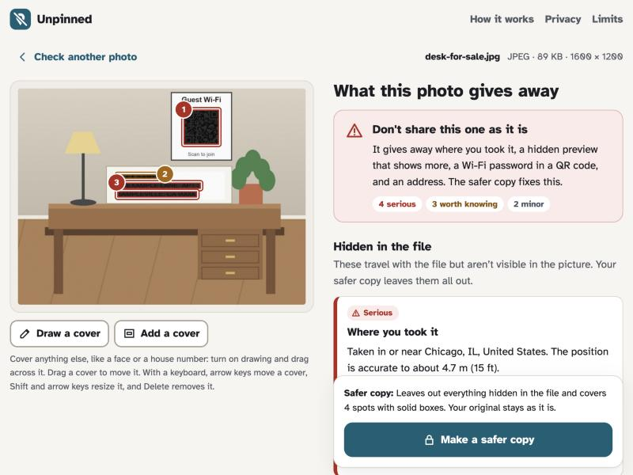
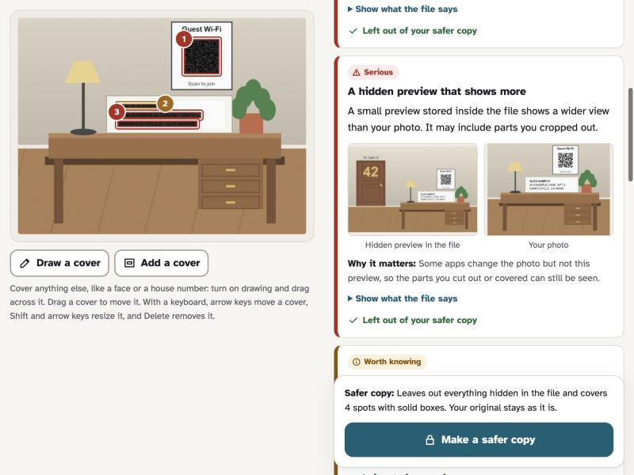
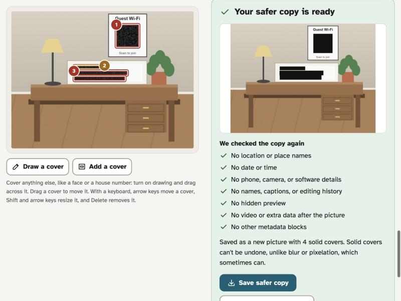

# Unpinned

**Check a photo before you share it.** Unpinned shows what a photo or screenshot gives away, like the exact spot
where you took it, a hidden preview that still shows what you cropped out, or a Wi-Fi password on the wall. Then it
makes a safer copy. Everything happens in your browser. Nothing is uploaded.

**Live demo:** https://ashank-crazy.github.io/unpinned/ · **Source:** https://github.com/ashank-crazy/unpinned ·
Made for [SafeSpace Hacks 2026](https://safespace-hacks.devpost.com/)



## Who it's for

People who share pictures with people they don't know well: selling or giving things away online, renting out a
room, posting in a community group, or sending photos to a landlord, school, or insurer. It matters most for anyone
whose location needs protecting, like someone who has moved away from an abusive partner or is being harassed
online, and for the advocates who help them.

## The risk

A photo can say more than the picture shows.

- **Hidden in the file.** Phones save the GPS position, often accurate to a few meters, plus the time, the phone
  model, and serial numbers. Editing apps add names, captions, and folder paths. Some files keep a small preview that
  still shows what you cropped out, a motion-photo video clip, or, because of the 2023 "aCropalypse" bugs in Google
  Pixel Markup and Windows Snipping Tool, the cropped-off part of a screenshot.
- **Visible but easy to miss.** An address on an envelope, a card number in a screenshot, a Wi-Fi QR code on the
  wall, or a boarding pass barcode holding your name and booking code.

Many social apps remove hidden details when you post, but email, cloud links, files sent as documents, and some
websites keep them. Most people have no easy way to see what their own photo carries.

## What it does

1. **Add a photo or screenshot.** Choose it, drop it, or paste it. On Android, the installed app also appears in the
   share sheet.
2. **See what it gives away, in plain words.** Each finding says what it is, why it matters, and how serious it is
   (Serious, Worth knowing, or Minor). A hidden preview is shown next to the photo so you can see the difference.
3. **Make a safer copy.** Everything hidden in the file is left out. The text and codes you tick, plus anything you
   draw over (a face, a house number), get solid covers. When nothing needs covering, the picture data is kept byte
   for byte, so there is no loss in quality.
4. **See that it worked.** The copy is read again with the same checks, and each result is listed. You can open the
   copy in Unpinned to check it yourself. Your original file is never changed, so it can still be kept as evidence.

## The safer outcome: one example

"Selling a desk" is a photo someone might post in a marketplace listing.

|                     | Before                                                                                               | After (safer copy)        |
| ------------------- | ---------------------------------------------------------------------------------------------------- | ------------------------- |
| Location            | GPS in Chicago, accurate to 4.7 m (15 ft), and the direction the camera faced                        | None                      |
| Hidden preview      | A preview inside the file still shows the cropped-out front door with the house number 42            | None                      |
| Time and device     | Monday, October 26, 2026 at 6:42 PM (UTC−05:00), "Demo Phone 7", and a unique photo ID               | None                      |
| In the picture      | A guest Wi-Fi QR code with its password, the name "Alex Sample", and a street address on an envelope | Covered with solid boxes  |
| Re-check            |                                                                                                      | All 7 checks pass         |

Opening the safer copy in Unpinned finds nothing hidden in the file and no personal text or codes in the picture.

| The hidden preview shows the cropped-out door                     | The safer copy, checked again                               |
| ----------------------------------------------------------------- | ----------------------------------------------------------- |
|  |  |

## One limitation

Unpinned can't recognize faces, house numbers on buildings, street signs, landmarks, license plates, or what is in
reflections and on screens. Its text reader works in English and can miss small, blurry, angled, or handwritten text.
The report asks people to look for these things and gives them a tool to cover them, but Unpinned can't promise a
photo is safe, and it can't take back a photo that has already been shared.

## Trust and privacy

- **Nothing leaves the device.** No server, no accounts, no analytics, no cookies. The page's Content Security Policy
  sets `connect-src 'self'`, so the browser itself blocks connections to any other site. The font, the text reader
  (Tesseract) and its English model, and the barcode reader (ZXing) are all served from the same site. No map service
  is used: GPS positions are turned into a nearby town name with a list of towns built into the app.
- **Works offline.** A service worker keeps the app and examples on the device, and the text reader is kept after
  its first use.
- **Covers are solid boxes,** never blur or pixelation, which tools like Unredacter have shown can sometimes be undone.
- **Sensitive values are masked on screen,** for example `•••• •••• •••• 1111`. Wi-Fi passwords and two-step login
  secrets are never displayed.
- **Uncertainty is shown.** When the text reader isn't confident, the finding says so. If text or code reading fails
  on a device, the report says the picture couldn't be fully checked instead of "nothing found".
- **Metadata is untrusted input.** Text from files is only ever put on the page as text, never as HTML.
- **No false promises.** Unpinned is a privacy tool, not a safety guarantee or an emergency service, and the page
  says so.
- **Accessible.** The Atkinson Hyperlegible font, severity shown with words and icons as well as color, covers that
  can be added, moved, and resized with a keyboard, screen-reader announcements, visible focus, light and dark themes,
  and reduced-motion support.

## Run it

Use the live demo, or run it locally with Node 22.12 or newer:

```bash
git clone https://github.com/ashank-crazy/unpinned.git
cd unpinned
npm install
npm run dev
```

Then open http://127.0.0.1:5180 and pick one of the three examples, or use your own photo. `npm install` also copies
the text reader's engine and English model (about 15 MB) into `public/vendor/`.

| Command                             | What it does                                                                                          |
| ----------------------------------- | ----------------------------------------------------------------------------------------------------- |
| `npm test`                          | Unit tests for the file readers, cleaning, re-checks, and detectors                                   |
| `npm run build && npm run preview`  | The production build at http://127.0.0.1:4180, with the security policy and offline support         |
| `npm run samples`                   | Regenerates the examples, test files, icons, and example previews (needs Python with Pillow and piexif) |

The examples are in `public/samples/`. Every name, address, booking code, card number, and network in them is made
up, and the GPS position is a public sculpture (Cloud Gate in Chicago), not a home.

Pushing to `main` deploys the site to GitHub Pages through `.github/workflows/pages.yml` (in the repository settings,
set Pages to deploy from GitHub Actions).

## How it works

| File                                         | Job                                                                                                                                                         |
| -------------------------------------------- | ----------------------------------------------------------------------------------------------------------------------------------------------------------- |
| `src/lib/container.ts`                       | Walks JPEG segments and PNG and WebP chunks to find metadata blocks, embedded previews, motion-photo video, and data after the end of the image             |
| `src/lib/metadata.ts`                        | Reads EXIF, XMP, and IPTC with exifr and sorts every field into plain-language groups                                                                      |
| `src/lib/places.ts`                          | Turns GPS coordinates into "in or near Chicago" using 23,338 towns from GeoNames, with no network                                                          |
| `src/lib/hidden.ts`                          | Writes the findings for what is hidden in the file                                                                                                          |
| `src/lib/image.ts`                           | Compares the embedded preview with the photo (shape, then a 24 × 24 fingerprint) and draws solid covers                                                    |
| `src/lib/ocr.ts`, `src/lib/barcodes.ts`      | Tesseract in a Web Worker and ZXing in WebAssembly find text and codes                                                                                      |
| `src/lib/sensitive-text.ts`                  | Finds addresses, card numbers (Luhn check), IBANs (mod 97 check), Social Security numbers, phone numbers, emails, names, and booking and account numbers   |
| `src/lib/barcode-text.ts`                    | Explains boarding passes (IATA BCBP), Wi-Fi, two-step login, map, contact, and link codes                                                                   |
| `src/lib/strip.ts`                           | Lossless cleaning: JPEG keeps only image data, the color profile, and orientation; PNG keeps a list of safe chunks; WebP drops EXIF and XMP                 |
| `src/lib/verify.ts`                          | Re-reads the copy with the same readers                                                                                                                     |
| `src/ui/`, `src/main.ts`                     | The interface, in plain TypeScript and DOM                                                                                                                  |
| `scripts/build-sw.mjs`                       | Writes the service worker for offline use and the Android share target                                                                                      |

## Built during SafeSpace Hacks

Everything in this repository was written during the event (October 17 to November 22, 2026): the file readers,
detectors, cleaning, checks, interface, examples, and tests. The pre-existing parts are the open-source libraries,
data, and font listed under Credits.

**AI assistance:** built with substantial help from Claude Code (Anthropic's AI coding assistant), which wrote much
of the code, tests, and text.

## Credits

| Component                                         | Used for                              | License                                         |
| ------------------------------------------------- | ------------------------------------- | ----------------------------------------------- |
| [exifr](https://github.com/MikeKovarik/exifr)     | Reading EXIF, XMP, and IPTC           | MIT                                             |
| [tesseract.js](https://github.com/naptha/tesseract.js) and tesseract.js-core | Reading text      | Apache 2.0                                      |
| English model from [tessdata](https://github.com/tesseract-ocr/tessdata), via @tesseract.js-data/eng | Reading text | Apache 2.0 (model), MIT (package) |
| [barcode-detector](https://github.com/Sec-ant/barcode-detector) and [zxing-wasm](https://github.com/Sec-ant/zxing-wasm) | Reading QR codes and barcodes | MIT |
| [ZXing-C++](https://github.com/zxing-cpp/zxing-cpp) | The barcode engine inside zxing-wasm | Apache 2.0                                      |
| [GeoNames](https://www.geonames.org/) via [all-the-cities](https://github.com/zeke/all-the-cities) | Town names | CC BY 4.0 (data), MIT (package) |
| [Atkinson Hyperlegible](https://www.brailleinstitute.org/freefont/) by the Braille Institute, via Fontsource | Font | SIL Open Font License 1.1 |
| Vite, Vitest, TypeScript                          | Building and testing                  | MIT, MIT, Apache 2.0                            |
| Pillow and piexif                                 | Generating the made-up examples       | MIT-CMU, MIT                                    |

Full notices are in [THIRD_PARTY_NOTICES.md](THIRD_PARTY_NOTICES.md). The icons and example pictures were made for
this project.

## License

MIT. See [LICENSE](LICENSE).
